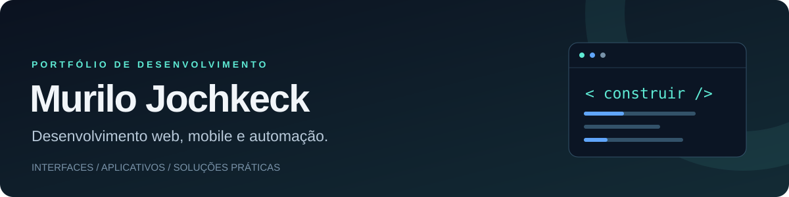

  

  <a href="#sobre-mim">Sobre mim</a> ·
  <a href="#tecnologias">Tecnologias</a> ·
  <a href="#projetos-e-contribuições">Projetos</a> ·
  <a href="mailto:murilojochkeck@gmail.com">Contato</a>

## Sobre mim

Sou **Murilo Jochkeck**, estudante do Técnico em Informática para Internet no **Instituto Federal Catarinense — Campus Concórdia**. Desenvolvo aplicações web, aplicativos multiplataforma e automações que conectam interfaces, APIs e dados para resolver problemas do dia a dia.

Minha experiência vem de projetos pessoais, acadêmicos e colaborativos: de aplicações financeiras em **Flutter** a plataformas web com **React e Next.js** e automações em **Python**. Tenho interesse em construir produtos úteis e aprimorar a qualidade do código, a experiência de uso e a organização dos projetos.

- **Web:** interfaces responsivas, autenticação e integração com serviços.
- **Mobile e desktop:** aplicativos em Flutter com persistência e consumo de APIs.
- **Automação:** processamento de documentos, validação de dados e fluxos com Python.

## Tecnologias

  
  
  
  
  
  
  
  

| Área | Tecnologias utilizadas nos meus projetos |
| :--- | :--- |
| **Interfaces web** | HTML, CSS, JavaScript, TypeScript, React, Next.js e Tailwind CSS |
| **Aplicativos** | Flutter, Dart e Material Design |
| **Backend e integrações** | Python, FastAPI, Supabase e APIs REST |
| **Dados** | SQL, PostgreSQL e SQLite |
| **Ferramentas e qualidade** | Git, GitHub, GitHub Actions, Playwright e testes automatizados |

## Projetos e contribuições

Uma seleção de projetos pessoais e trabalhos em equipe. Os links levam aos repositórios com código e documentação.

| Projeto | Proposta | Tecnologias |
| :--- | :--- | :--- |
| **[MatchCV](https://github.com/MuriloJochkeck/matchcv)** | Plataforma para comparar currículo e vaga, com análise explicável, autenticação e processamento de PDFs. | Next.js · React · TypeScript · Supabase |
| **[Bolsa Fácil](https://github.com/PramioIFC/Bolsa_Facil)** | Contribuição em aplicativo para acompanhar ações da B3, organizar favoritos e simular uma carteira de investimentos. | Flutter · Dart · SQLite · API brapi |
| **[NFAuto](https://github.com/MuriloJochkeck/nfauto)** | Projeto de automação para extrair dados de documentos fiscais e preparar preenchimentos com revisão do usuário. | Python · FastAPI · Playwright · SQLite |
| **[Nexoflow](https://github.com/MuriloJochkeck/nexoflow)** | Aplicativo acadêmico voltado à gestão de renda, desenvolvido nas aulas de dispositivos móveis. | Flutter · Dart |
| **[Projeto Integrador](https://github.com/MuriloJochkeck/Projeto-Integrador-Grupo-1)** | Desenvolvimento colaborativo de um site para o Projeto Integrador II do IFC. | Desenvolvimento web · Trabalho em equipe |

## Como desenvolvo

Nos projetos, venho aplicando separação de responsabilidades, validação de dados, testes automatizados e documentação de decisões. Também procuro cuidar da acessibilidade, do tratamento de erros e da proteção das informações dos usuários.

## Contato

Para conversar sobre projetos, tecnologia ou colaboração: **[murilojochkeck@gmail.com](mailto:murilojochkeck@gmail.com)**.
