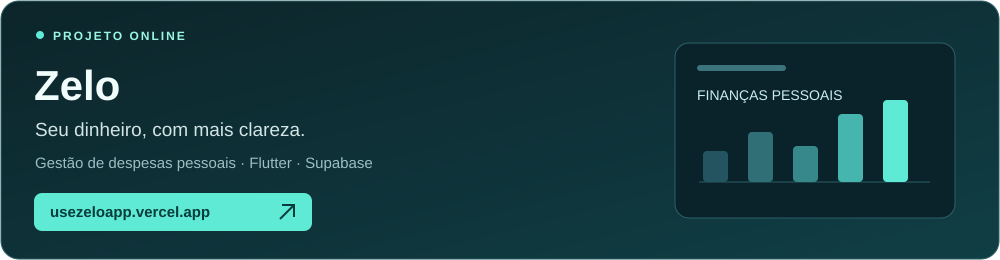

  <a href="#sobre-mim">Sobre mim</a> ·
  <a href="#tecnologias">Tecnologias</a> ·
  <a href="#projetos-online">Projetos online</a> ·
  <a href="#projetos-e-contribuições">Portfólio</a> ·
  <a href="#atividade-no-github">GitHub</a> ·
  <a href="mailto:murilojochkeck@gmail.com">Contato</a>

  

## Sobre mim

Sou **Murilo Victor Jochkeck**, estudante do Técnico em Informática para Internet no **Instituto Federal Catarinense — Campus Concórdia**.

Minha experiência vem de projetos pessoais, acadêmicos e colaborativos. Tenho interesse em construir produtos úteis e aprimorar a qualidade do código, a experiência de uso e a organização dos projetos.

- **Web:** interfaces responsivas, autenticação e integração com serviços.
- **Mobile e desktop:** aplicativos em Flutter com persistência e consumo de APIs.
  
## Tecnologias

  
  
  
  
  
  
  
  

| Área | Tecnologias utilizadas nos meus projetos |
| :--- | :--- |
| **Interfaces web** | HTML, CSS, JavaScript, TypeScript, React, Next.js e Tailwind CSS |
| **Aplicativos** | Flutter, Dart e Material Design |
| **Backend e integrações** | Python, FastAPI, Supabase e APIs REST |
| **Dados** | SQL, PostgreSQL e SQLite |
| **Ferramentas e qualidade** | Git, GitHub, GitHub Actions, Playwright e testes automatizados |

## Projetos online

**[Acessar o Zelo ↗](https://usezeloapp.vercel.app/)** · Aplicativo de gestão de despesas pessoais, desenvolvido com Flutter e Supabase.

## Projetos e contribuições

Uma seleção de projetos pessoais e trabalhos em equipe. Os links levam aos repositórios com código e documentação.

| Projeto | Proposta | Tecnologias |
| :--- | :--- | :--- |
| **[MatchCV](https://github.com/MuriloJochkeck/matchcv)** | Plataforma para comparar currículo e vaga, com análise explicável, autenticação e processamento de PDFs. | Next.js · React · TypeScript · Supabase |
| **[Bolsa Fácil](https://github.com/PramioIFC/Bolsa_Facil)** | Contribuição em aplicativo para acompanhar ações da B3, organizar favoritos e simular uma carteira de investimentos. | Flutter · Dart · SQLite · API brapi |
| **[Nexoflow](https://github.com/MuriloJochkeck/nexoflow)** | Aplicativo acadêmico voltado à gestão de renda, desenvolvido nas aulas de dispositivos móveis. | Flutter · Dart |
| **[Projeto Integrador](https://github.com/MuriloJochkeck/Projeto-Integrador-Grupo-1)** | Desenvolvimento colaborativo de um site para o Projeto Integrador II do IFC. | Desenvolvimento web · Trabalho em equipe |

## Atividade no GitHub

  
  

  
  
  

Os cartões mostram dados públicos e podem levar algum tempo para atualizar. A distribuição de linguagens reflete os repositórios analisados.

### Colaboração

Além dos projetos pessoais, participo de trabalhos em equipe, como o **[Bolsa Fácil](https://github.com/PramioIFC/Bolsa_Facil)**, o **[biblioFacil](https://github.com/JoaoPilger/biblioFacil)** e o **[Projeto Integrador](https://github.com/MuriloJochkeck/Projeto-Integrador-Grupo-1)**.

## Como desenvolvo

## Contato

Para conversar sobre projetos, tecnologia ou colaboração: **[LinkedIn](https://www.linkedin.com/in/murilo-victor-jochkeck-a084602b9/)** · **[murilojochkeck@gmail.com](mailto:murilojochkeck@gmail.com)**.
